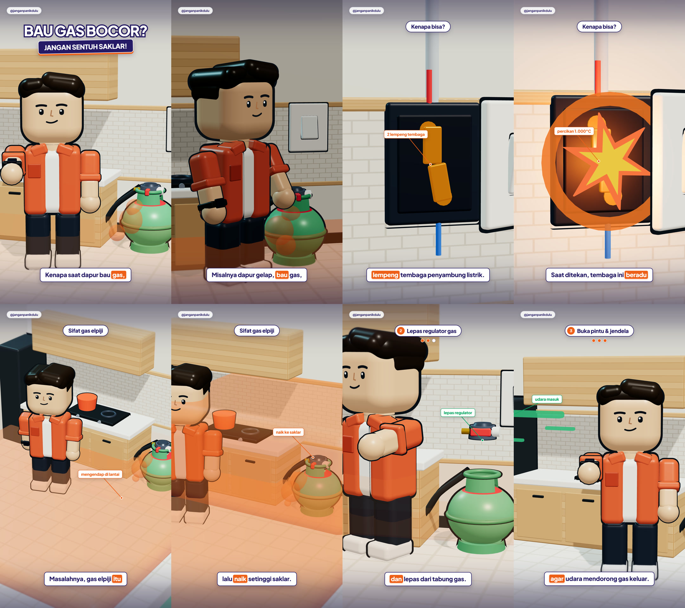

# EP01 — Bau Gas Bocor? Jangan Sentuh Saklar! (LOCKED SCRIPT & ELEVENLABS VO KIT)

## 1. Naskah Utama Terkunci (`~35 Detik` | Lugas, Jelas, Tanpa Kiasan)

```text
Kenapa saat dapur bau gas, kamu nggak boleh nyentuh saklar lampu?
Karena satu klik saklar bisa langsung memicu ledakan.
Misalnya dapur gelap, tercium bau gas, lalu tangan refleks menekan saklar.

Di dalam saklar, ada dua lempeng tembaga penyambung listrik.
Saat ditekan, tembaga ini beradu dan memercikkan api kecil bersuhu 1.000 derajat.
Masalahnya, gas elpiji dua kali lebih berat dari udara.
Saat bocor, gas tidak naik ke atas, tapi mengendap di lantai lalu naik sampai setinggi saklar.
Mau saklar dinyalakan atau dimatikan, percikan apinya tetap keluar dan langsung menyambar gas.

Kalau mencium bau gas, lakukan 3 langkah ini:
Pertama, jangan sentuh saklar lampu atau alat elektronik apa pun.
Kedua, putar pengunci regulator dan lepas dari tabung gas.
Ketiga, buka pintu dan jendela lebar-lebar supaya udara luar mendorong gas keluar.

Jadi yang memicu ledakan bukan tabungnya, tapi percikan listrik saat kita panik.
Jadi... jangan panik dulu.
```

---

## 2. Kit ElevenLabs Voiceover (Mas Raka Persona)

### A. Teks Siap Copy-Paste ke ElevenLabs (Phonetic-Optimized Tanpa Tag)
*(Semua angka sudah ditulis huruf — `seribu derajat`, `tiga langkah` — agar lafal bahasa Indonesia 100% mulus dan jeda antarkalimat terbaca jelas untuk ekstraksi timestamp otomatis).*

```text
Kenapa saat dapur bau gas, kamu nggak boleh nyentuh saklar lampu?
Karena satu klik saklar, bisa langsung memicu ledakan.
Misalnya dapur gelap, tercium bau gas, lalu tangan refleks menekan saklar.

Di dalam saklar, ada dua lempeng tembaga penyambung listrik.
Saat ditekan, tembaga ini beradu dan memercikkan api kecil bersuhu seribu derajat.
Masalahnya, gas elpiji dua kali lebih berat dari udara.
Saat bocor, gas tidak naik ke atas, tapi mengendap di lantai, lalu naik sampai setinggi saklar.
Mau saklar dinyalakan atau dimatikan, percikan apinya tetap keluar dan langsung menyambar gas.

Kalau mencium bau gas, lakukan tiga langkah ini.
Pertama, jangan sentuh saklar lampu atau alat elektronik apa pun.
Kedua, putar pengunci regulator, dan lepas dari tabung gas.
Ketiga, buka pintu dan jendela lebar-lebar, supaya udara luar mendorong gas keluar.

Jadi yang memicu ledakan bukan tabungnya, tapi percikan listrik saat kita panik.
Jadi... jangan panik dulu.
```

### B. Teks dengan Expression Tags (Khusus Model ElevenLabs v3/v4 yang Mendukung Audio Tags)
```text
[curious, engaging] Kenapa saat dapur bau gas, kamu nggak boleh nyentuh saklar lampu?
[serious, punchy] Karena satu klik saklar, bisa langsung memicu ledakan.
Misalnya dapur gelap, tercium bau gas, lalu tangan refleks menekan saklar.

[clear, informative] Di dalam saklar, ada dua lempeng tembaga penyambung listrik.
Saat ditekan, tembaga ini beradu dan memercikkan api kecil bersuhu seribu derajat.
Masalahnya, gas elpiji dua kali lebih berat dari udara.
Saat bocor, gas tidak naik ke atas, tapi mengendap di lantai, lalu naik sampai setinggi saklar.
[firm] Mau saklar dinyalakan atau dimatikan, percikan apinya tetap keluar dan langsung menyambar gas.

[calm, authoritative] Kalau mencium bau gas, lakukan tiga langkah ini.
Pertama, jangan sentuh saklar lampu atau alat elektronik apa pun.
Kedua, putar pengunci regulator, dan lepas dari tabung gas.
Ketiga, buka pintu dan jendela lebar-lebar, supaya udara luar mendorong gas keluar.

[thoughtful] Jadi yang memicu ledakan bukan tabungnya, tapi percikan listrik saat kita panik.
[warm, calm smile] Jadi... jangan panik dulu.
```

### C. Voice Design Prompt (Jika Membuat / Memilih Suara Karakter Mas Raka)
```text
A 27-year-old Indonesian male voice with a warm, clear, medium-low baritone timbre. Calm, reliable, and articulate like a smart older brother explaining science and emergency safety. Brisk, engaging educational pacing, natural Jakarta-Indonesian conversational intonation, recorded closely on a crisp broadcast studio condenser microphone with zero room echo.
```

### D. Rekomendasi Setelan Slider ElevenLabs
- **Speed**: `1.06` – `1.10` *(sedikit cepat dan sigap agar ritme padat)*
- **Stability**: `55%` *(cukup ekspresif di bagian Hook tapi stabil saat menjelaskan poin 1–3)*
- **Similarity**: `80%`
- **Style Exaggeration**: `20%`


---

## 3. Spesifikasi Produksi Visual & Audio (Revisi 5 Evaluasi Terkunci)

- **Durasi Master Voiceover (`vo_ep01.mp3`)**: `59.56 detik` (14 kalimat).
- **Audio Master (`audio_ep01_master.wav` / `.mp3`)**:
  - Voiceover utama Mas Raka + *Procedural Sound Design* profesional (*LPG hiss*, *mechanical click*, *1.000°C electrical spark*, *low gas rumble*, *regulator unlock clunk*, *window slide & breeze*, serta *Motion Graphic whoosh, UI pop, & callout draw tick*).
- **5 Standar Visual Hasil Evaluasi**:
  1. **Watermark Akun Tipis & Elegan**: `@janganpanikdulu` (`23px`, `font-weight: 500`, `rgba(255,255,255,0.58)`) tanpa inisial `jpd` dan tanpa kotak kapsul gelap.
  2. **Word-by-Word Karaoke Caption**: Subtitle bawah (`42px ExtraBold`) menghighlight per kata secara *real-time* mengikuti ucapan VO di dalam kotak solid `#EF5F18`.
  3. **Hirarki Overlay Terpusat (`@puckermanefacts` × `bang-motion`)**: Menghapus Bento Card kecil di samping; menggunakan **Top Step Pill** + **Sub-Pill Metrik Besar (`33px`)** tepat di bawahnya + **1 Callout 3D** dengan animasi masuk/keluar `easeOutBack` / `easeInQuad` dan garis penunjuk yang menggambar progresif.
  4. **Model 3D Tabung Gas 3kg ("Gas Melon") Indonesia & Cutaway Saklar**: Tabung bulat gemuk hijau muda (`LPG 3 KG — HANYA UNTUK MASYARAKAT MISKIN`), sabuk las tengah, kerudung katup berlubang samping, regulator + manometer + selang gas fleksibel ke kompor, serta saklar dinding *slide-open cutaway* di atas keramik *subway tile*.
  5. **Komposisi Kamera Narrow-FOV (`22°–25°`) 3/4 Cutaway**: Sudut 3/4 arsitektural konsisten; tabung gas tidak pernah bocor di bawah kotak subtitle saat *close-up* saklar.



---

## 4. Kit Upload Multi-Platform (Instagram Reels, TikTok, & Facebook Reels)

### A. 3 Opsi Thumbnail / Cover (`1080×1920` dengan Safe-Zone Grid `1:1` & `4:5`)
- **Opsi 1 (`thumb_ep01_opsi_1.png`)**: *Visual X-Ray Curiosity* — Cutaway saklar memercikkan api `1.000°C` + uap gas oranye merayap naik (`BAU GAS BOCOR? / JANGAN SENTUH SAKLAR LAMPU!`).
- **Opsi 2 (`thumb_ep01_opsi_2.png`)**: *Dark Kitchen Drama* — Skenario dapur gelap penuh gas saat tangan refleks menekan saklar (`1 KLIK = MELEDAK? / BAHAYA SAKLAR SAAT BAU GAS`).
- **Opsi 3 (`thumb_ep01_opsi_3.png`)**: *Clean Isometric Diorama* — Tampilan utuh dapur isometrik khas `@puckermanefacts` (`JANGAN PANIK DULU / BAU GAS BOCOR DI DAPUR?`).
- **Lembar Perbandingan 3 Opsi**: [`vault/assets/thumb_ep01_3_opsi_sheet.jpg`](file:///d:/Jangan%20Panik%20Dulu%20-%20Motion/vault/assets/thumb_ep01_3_opsi_sheet.jpg)

### B. Caption Instagram Reels (Fokus *Save* & *Share* ke Grup Keluarga)
```text
Cium bau gas di dapur? Tahan tanganmu, jangan sentuh saklar lampu.

Banyak yang mengira ledakan gas terjadi karena tabungnya tiba-tiba meledak sendiri. Padahal pemicu utamanya justru 1 klik saklar listrik saat kita panik.

Di dalam saklar dinding, ada 2 lempeng tembaga penyambung arus listrik. Saat kamu tekan ON ataupun OFF, dua tembaga ini beradu dan memercikkan bunga api kecil bersuhu sekitar 1.000°C.

Masalahnya, gas elpiji (LPG) 2 kali lebih berat daripada udara. Saat bocor, gas tidak terbang ke plafon, melainkan mengendap di lantai dapur lalu menumpuk naik sampai setinggi saklar. Begitu saklar ditekan, percikan 1.000°C tadi langsung menyambar gas di ruangan.

Kalau tercium bau gas di rumah, lakukan 3 langkah ini:
1. Jangan nyalakan atau matikan saklar lampu, kipas angin, maupun alat elektronik apa pun.
2. Putar pengunci regulator dan lepas dari tabung gas.
3. Buka pintu dan jendela lebar-lebar supaya udara luar mendorong gas keluar.

Simpan video ini dan bagikan ke grup WhatsApp rumah/keluarga supaya semua orang di rumah tahu apa yang harus dilakukan.

Pernah ngalamin bau gas mendadak di dapur? Apa yang pertama kali kamu lakukan waktu itu?

#janganpanikdulu #edukasidarurat #baugas #gasbocor #tipsdapur #keselamatankeluarga #faktasains #pertolonganpertama
```

### C. Caption TikTok (Singkat, *Search-Engine Optimized* untuk Kolom Pencarian TikTok)
```text
Kenapa nggak boleh nyentuh saklar lampu saat dapur bau gas? Ternyata di dalam saklar ada 2 lempeng tembaga yang memercikkan api 1.000°C saat ditekan ON maupun OFF.

Karena gas elpiji 2x lebih berat dari udara, gas yang bocor mengendap di lantai lalu naik sampai setinggi saklar.

3 langkah aman saat mencium bau gas:
1. Jangan sentuh saklar lampu atau alat elektronik apa pun.
2. Putar pengunci regulator dan lepas dari tabung gas.
3. Buka pintu dan jendela lebar-lebar agar udara luar mendorong gas keluar.

Save & share ke keluarga di rumah. Kira-kira bahas kondisi darurat apa lagi di episode berikutnya?

#janganpanikdulu #gasbocor #tipsdapur #faktasains #edukasidarurat #keselamatanrumah #fypindonesia
```

### D. Caption Facebook Reels / Halaman Facebook (Gaya Cerita Relatable + Pemicu Diskusi Komentar Ibu/Bapak Rumah Tangga)
```text
Masih banyak yang belum tahu: saat masuk dapur yang gelap dan tercium bau gas, refleks menyalakan saklar lampu justru hal paling berbahaya.

Meskipun saklar terlihat tertutup rapat dari luar, di dalamnya ada dua lempeng tembaga yang beradu setiap kali ditekan—baik saat dinyalakan maupun dimatikan—dan menghasilkan percikan api kecil bersuhu 1.000 derajat Celsius.

Karena sifat gas elpiji 2 kali lebih berat dari udara, gas bocor selalu mengendap di bawah dan memenuhi ruangan sampai setinggi saklar.

Ingat 3 langkah aman ini untuk orang rumah:
1. Biarkan posisi saklar lampu apa adanya (jangan dinyalakan dan jangan dimatikan).
2. Lepas pengunci regulator dari tabung gas 3kg/12kg.
3. Buka pintu dan jendela dapur lebar-lebar supaya angin mendorong sisa gas keluar.

Boleh bagikan postingan ini ke keluarga atau pasangan di rumah supaya sama-sama waspada. Kalau di rumah Anda, tabung gas ditaruh di ruang terbuka atau di dalam kabinet tertutup?

#JanganPanikDulu #TipsRumahTangga #GasElpiji #KeamananDapur #EdukasiKeluarga
```
